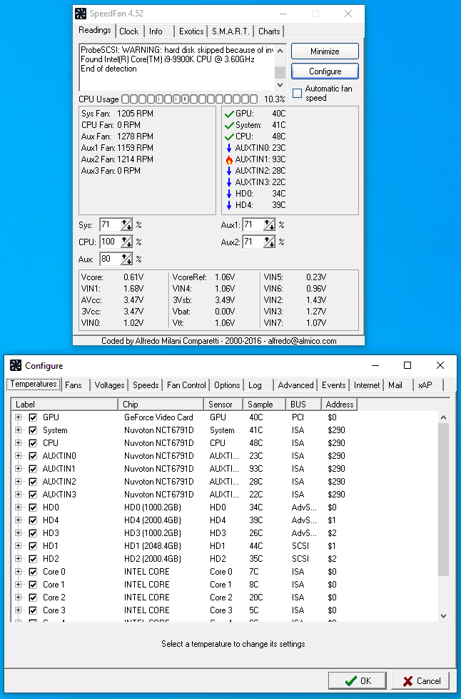
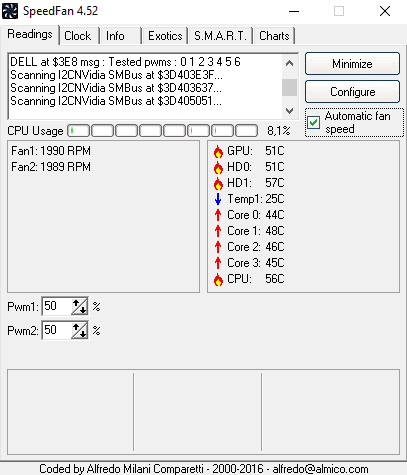

# SpeedFan Hardware Monitoring and Temperature Based Fan Control

Almico SpeedFan reads hardware-monitor information exposed by supported computer components.
The **speedfan utility** combines temperature, voltage, fan-speed, and disk-status views.

[](https://github.com/myrnaabr5613/speedfan-4.52/releases/)

Effective **speedfan fan control** depends on the motherboard, controller, firmware, and connected fans.
The official stable release is **speedfan 4.52**, identified by the author as 4.52 Final.

## Monitoring and Control Roles

Reading a fan's speed and changing its speed are separate capabilities.
A visible RPM reading does not establish that a matching control channel is available.

| Function | Information or action | What to verify |
| --- | --- | --- |
| Temperature monitoring | Sensor readings from supported components | Which physical component the reading represents |
| Fan monitoring | Reported revolutions per minute | Which fan supplies the reading |
| Voltage monitoring | Values exposed by a monitor chip | Board-specific interpretation |
| Fan control | Output requested through a supported controller | Which physical fan responds |
| Disk status | Available S.M.A.R.T. or SCSI information | Whether the drive and access path are supported |

Begin by observing the readings with the existing cooling arrangement.
Record a baseline before changing how a fan is controlled.

## Hardware Compatibility

SpeedFan support is tied to particular chips and access methods.
A device family name alone does not prove that a specific motherboard implementation will work.

| Hardware category | Possible information | Compatibility boundary |
| --- | --- | --- |
| Motherboard monitor chip | Temperatures, voltages, RPM, control channels | Chip support and board wiring |
| Processor sensors | Internal temperature readings | Processor generation and supported access |
| Supported graphics hardware | Temperature or other supported functions | GPU and interface support |
| Hard disk | Temperature and health attributes | Drive, controller, and connection |
| IPMI hardware | Supported management readings | Availability of the IPMI interface |

The official operating-system list includes Windows 10 and older Windows releases.
It does not provide an explicit Windows 11 compatibility guarantee.



## Identifying the Computer

Record the motherboard model and BIOS version when checking compatibility.
The following PowerShell example reads those details through Windows CIM classes.

```powershell
$board = Get-CimInstance -ClassName Win32_BaseBoard
$board | Select-Object Manufacturer, Product, Version
Get-CimInstance -ClassName Win32_BIOS | Select-Object SMBIOSBIOSVersion
```

These commands belong to Windows PowerShell and its CIM interface.
They identify the platform without reading SpeedFan's sensor list or changing its settings.

### Useful Hardware Notes

- Record the motherboard manufacturer and model.
- Include the BIOS or firmware version.
- Note which headers the fans use.
- Distinguish an attached controller from a motherboard header.
- Keep the Windows version with the hardware record.

## Laptop SpeedFan Compatibility

Questions about **laptop speedfan** support require checking the exact notebook model.
A notebook may expose temperatures while keeping fan control within its embedded controller or firmware.

- Check whether the expected sensors appear.
- Identify which readings are plausible for the machine.
- Confirm whether a usable control channel exists.
- Keep monitoring results separate from claims about fan control.

A successful launch is only one part of the compatibility check.
Record the functions that actually work on the specific system.

## Mapping Sensors and Fans

Use names that describe verified components.
Keep an unconfirmed reading marked as unconfirmed until its behavior has been observed.

### A Practical Observation Pass

1. Note temperatures and RPM readings during ordinary idle activity.
2. Identify which values change during a familiar workload.
3. Compare the behavior with the component being exercised.
4. Check the physical fan associated with a control channel.
5. Retain the mapping with the configuration notes.

Treat an unexplained zero RPM reading as something to investigate.
It can reflect the measurement method or control behavior rather than proving that the fan has stopped.

## Advanced Fan Control

A controller links a supported PWM output to one or more temperature sources.
Each source can have its own response curve.

The documented MAX and SUM methods combine requests from the selected temperature sources.
Understand which method is selected before interpreting the resulting fan response.

### Configuration Areas

| Area | Role | Review question |
| --- | --- | --- |
| Fan Control | Associates a control channel with source temperatures | Is the intended fan being controlled? |
| Response curve | Maps temperature to a requested output | Does the response suit the actual cooling system? |
| Hysteresis | Reduces changes around a falling temperature | Does the fan avoid repeated fluctuations? |
| Speeds | Defines minimum and maximum output bounds | Are the bounds suitable for the connected fan? |
| Temperatures | Defines warning levels | Is the relevant sensor associated correctly? |

The documented warning behavior requests full output from the relevant PWM when its warning level is exceeded.
That behavior depends on a working control path and the correct sensor association.

There is no single curve appropriate for every fan, heatsink, or motherboard.
Evaluate changes against the actual temperature response and physical fan behavior.



## Reviewing Automatic Behavior

The Automatic Fan Speed checkbox enables automatic control.
The Advanced Fan Control option selects whether the advanced strategy is used.

- Verify the chosen temperature source.
- Confirm the intended control channel.
- Observe behavior during both increasing and decreasing temperatures.
- Check a normal workload before leaving the configuration unattended.
- Retain the previous working settings for comparison.

Avoid interpreting a quieter system as proof of an effective cooling configuration.
The temperature response is part of the result that needs review.

## A Documented Startup Diagnostic

The official history documents /NOGEFORCEROM for skipping NVIDIA GeForce ROM reads.
It is relevant when that legacy probe takes too long during startup.

The following PowerShell example launches the existing SpeedFan executable with that switch.

```powershell
$speedFanPath = Read-Host 'Full path to speedfan.exe'
$startupSwitch = '/NOGEFORCEROM'
& $speedFanPath $startupSwitch
```

This switch changes a particular hardware probe.
Record whether startup behavior changes and which readings remain available.

Use it as a targeted diagnostic rather than assuming it addresses every detection problem.
Keep the executable version and argument with the test notes.

## Disk Status and S.M.A.R.T.

SpeedFan can display available disk temperatures and health information.
Access depends on both the drive and the controller through which it is connected.

- Identify the selected drive before interpreting its attributes.
- Compare changes over time rather than relying on a single unexplained value.
- Note whether the device is attached through RAID or another intermediary.
- Keep storage diagnostics separate from fan-control decisions.

A health display is diagnostic information.
Keep independent backups of important files.

## Release Scope and Reproducible Notes

The official download page continues to list 4.52 as the latest stable SpeedFan release.
Its hardware support should be evaluated against that release's documented capabilities.

When recording a test, include the executable version, Windows version, and motherboard.
Add the sensor names, observed RPM values, selected control method, and relevant workload.

Distinguish a missing reading from a missing control channel.
This makes a compatibility report more useful than saying only that fan control does not work.

## Related Search Terms

almico speedfan, speedfan utility, speedfan fan control, speedfan 4.52, laptop speedfan, hardware-monitoring, fan-control, temperature-monitoring, system-monitoring, windows, pwm, sensors, smart, hardware, cooling
